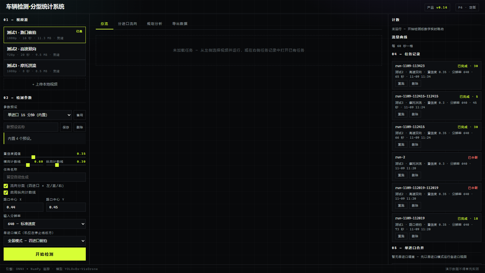
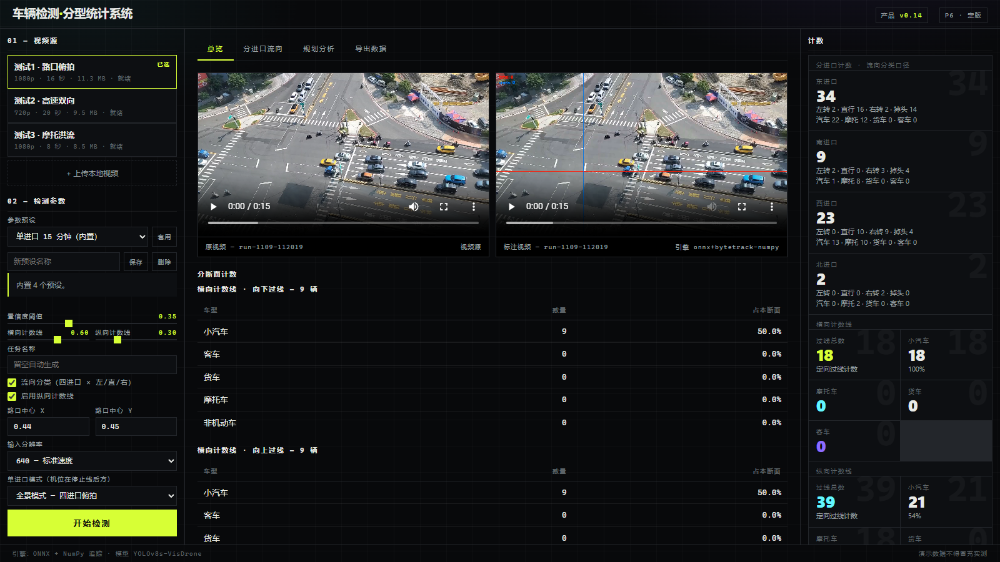

# 车辆检测与分型统计系统 · Windows 桌面端

> 把一段路口或断面视频交给它，自动完成「检测 → 追踪 → 过线计数 → 分型 → 分进口流向 → 路口规划分析 → 导出报告」的完整车流调查流水线。
>
> YOLOv8s（VisDrone 版，ONNX Runtime CPU 推理）+ ByteTrack 追踪 + pywebview 原生窗口，双击即用，不需要装 Python、不需要联网。





---

## 功能

- **检测与追踪**：内置 `models/yolov8s-visdrone.onnx`（俯拍场景微调权重），ByteTrack 多目标追踪，输出带检测框、轨迹 ID、计数线的标注视频。
- **双计数线过线计数**：横向计数线（南北向断面）+ 可开关的纵向计数线（东西向断面），按车型分型统计，轨迹投票纠正单帧误分类。
- **分方向计数**：断面任务不再只给双向混总数，向下过线 / 向上过线各一块大数字，各带分车型与占比；时段流量曲线为分方向双色柱。
- **分进口计数**：路口任务的东 / 南 / 西 / 北四进口大数字（流向分类口径），每块带左 / 直 / 右 / 掉头与分车型，随车流实时跳动。
- **路口流向图**：十字路口示意图上 12 条流向箭头，粗细正比于流量（直行 / 左转 / 右转三色），点按箭头查看该流向的分车型构成。
- **规划分析**：各流向 pcu 流量、通行能力、饱和度、服务水平、Webster 建议周期与绿灯分配、问题诊断与「+1 车道」情景测算。
- **导出**：结果页一键导出 `report.xlsx` / `report.pdf`，内容与页面五部分一致。
- **实时流输入**：支持流地址 + 录制时长，边收边检测（CPU 跟不上流速时会丢帧，计数为实际处理帧的过线数）。
- **任务队列与预设**：单 worker 严格按序执行，运行中可停止并保留已出结果；内置 4 套参数预设（路口俯拍 640 / 摩托增强 1280 / 高速断面 / 单进口 15 分钟），可自命名保存。

## 目录结构

```
.
├── app.py                      # 入口：起本地 Web 服务 + 打开原生窗口
├── src/
│   ├── desktop_shell.py        # pywebview 原生窗口（失败自动退回浏览器）
│   ├── server.py               # 本地 HTTP 服务与接口
│   ├── engine.py               # 检测/追踪/计数主流水线（含 ffmpeg 转码）
│   ├── onnx_detector.py        # ONNX Runtime 推理封装
│   ├── tracker.py              # ByteTrack 追踪
│   ├── counting.py             # 过线判定 + ID 去重 + 类别投票
│   ├── movements.py            # 分进口 / 左直右 / 掉头 流向分类
│   ├── planning.py             # 通行能力、饱和度、Webster 配时、情景测算
│   ├── report_export.py        # Excel / PDF 报告
│   ├── merge_surveys.py        # 单进口任务合并成全景
│   └── paths.py                # 资源与输出路径
├── ui/                         # 工作台界面（index.html / app.js / style.css）
├── data/                       # 参数预设、路口几何模板
├── models/                     # yolov8s-visdrone.onnx（随仓库携带）
├── test-videos/                # 三段内置测试视频（随仓库携带）
├── build_windows.bat           # PyInstaller 构建脚本
├── vehicle-count.spec          # 打包配置
├── requirements-packaging.txt  # 运行 + 打包依赖（含版本 pin）
├── 使用手册.md / 验收报告.md / 构建说明.md / THIRD_PARTY.md
```

## 快速开始

### 方式一：直接用源码跑（Windows / Linux，Python 3.11 或 3.12）

```bash
python -m pip install -r requirements-packaging.txt
python app.py
```

- `python app.py` — 打开原生桌面窗口（Windows 用 WebView2；窗口起不来会自动退回浏览器打开 `http://127.0.0.1:8931/`）
- `python app.py --browser` — 直接用系统浏览器打开
- `python app.py --no-browser` — 只起服务，不弹窗口（适合跑长任务，关窗口不会中断）
- `python app.py --port 8940` — 换端口
- `python app.py --version` — 打印版本号

首次打开后：左侧「01 视频源」选内置测试视频或上传自己的 mp4 → 「02 检测参数」用预设或按需调置信度 / 计数线 → 「开始检测」。

### 方式二：打包成单文件目录版 exe

1. 把仓库放到**纯英文路径**（如 `C:\VehicleCount-build\`）。
2. 到 <https://www.gyan.dev/ffmpeg/builds/> 下载 essentials 静态包，把 `ffmpeg.exe` 放进 `tools\` 目录（缺了它构建脚本会直接报错退出）。
3. 双击 `build_windows.bat`：自动安装依赖并用 PyInstaller 构建。
4. 产物在 `dist\VehicleCount\VehicleCount.exe`（one-folder 形式，exe 与 `_internal\` 必须一起拷走）。

## 实测结果（本机 Windows 11，纯 CPU）

| 用例 | 视频 | 指标 | 本机实测 |
|---|---|---|---|
| TEST1 路口俯拍 | 1080p · 16 s | 总数 / 横线 / 竖线 / 轨迹 | **18 / 18 / 39 / 187** |
| TEST2 高速双向 | 720p · 20 s | 总数（分方向） | **30**（向下 17 / 向上 13） |
| TEST3 摩托洪流 | 1080p · 8 s | 总数 | **5** |

**关于 TEST1 的 18 与 19**：构建说明给出的基准是「总 19 / 横 19 / 纵 39 / 轨迹 180」，那是 Linux 开发机的数值。Windows 构建在本机连跑多次稳定在 18 / 39 / 187，已排除依赖版本、检测抖动、丢帧、阈值四类原因，定性为 Windows 与 Linux 之间 ONNX Runtime CPU EP 的数值差异（个别车辆的置信度卡在阈值附近）。TEST2、TEST3 与基准完全一致。

## 已知限制

- **跨平台数值差异**：如上，TEST1 横线少 1 辆；如需完全对齐基准，可在 `src/counting.py` 的过线判定上加滞回（连续 N 帧在对侧才计数），目前未改产品代码。
- **关窗口即停服务**：默认桌面窗口模式下，关闭窗口会结束服务，正在跑的任务会中断；跑批量任务请用 `--no-browser`。
- **CPU 推理慢**：640 档约 0.8 帧/秒，16 秒 1080p 视频约 5 分钟；1280 档耗时再 ×3–4。无 GPU 时建议短片段或抽帧。
- **原视频播放是否流畅取决于本机解码能力**，与引擎处理速度是两回事。
- **WebView2 依赖**：Windows 上没有 WebView2 运行时无法开原生窗口（会自动退回浏览器方式，功能相同）。
- **输出体积**：任务结果（标注视频等）写在 `outputs/` 下，长期使用需自行清理。

## 第三方与许可

- 检测模型：Ultralytics YOLOv8（AGPL-3.0），权重为 VisDrone 场景微调版本；详见 `THIRD_PARTY.md`。
- 追踪：ByteTrack 思路自实现（无第三方依赖）。
- 推理 / 依赖：ONNX Runtime、OpenCV、NumPy、openpyxl、ReportLab、pillow、pywebview。
- 视频转码：ffmpeg（打包时随包携带，仓库不含二进制，需自行下载）。
- 本项目代码：MIT License，见 `LICENSE`。

## 致谢

界面与文档口径来自毕业设计（智能交通技术）产品化迭代；验收数字与限制说明见 `验收报告.md`、`构建说明.md`、`使用手册.md`。
